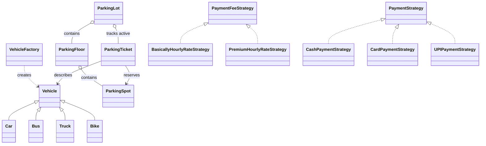
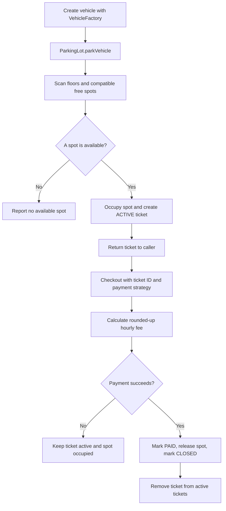

# Parking Lot — Revision Notes

This is a minimal, single-file Java parking-lot example. The existing model
classes are kept in `Parkinng_lot.java`; the implementation is completed with
vehicle entry, ticket creation, fee calculation, payment, and checkout.

## Compile and run

```powershell
javac Parkinng_lot.java
java Parkinng_lot
```

Expected output:

```text
Parked at spot B-1
Checkout successful. Fee: 10.0
Ticket status: CLOSED
```

The runnable example first verifies that declined payment leaves the ticket
active and its spot occupied, then retries checkout with an accepted payment.

## Class diagram



## Parking and checkout flow



## Ticket states

```mermaid
stateDiagram-v2
    [*] --> ACTIVE: vehicle parked
    ACTIVE --> ACTIVE: payment fails; retry checkout
    ACTIVE --> PAID: payment succeeds
    PAID --> CLOSED: spot released
    CLOSED --> [*]
```



## Important code behavior

- **VehicleFactory** selects `Car`, `Bus`, `Truck`, or `Bike` from `VehicleType`.
- **ParkingSpot** accepts a vehicle only when the spot is free and types match.
- **ParkingFloor** stores spots and can find an available spot for a vehicle.
- **ParkingTicket** records its ID, vehicle, spot, entry/exit times, floor index,
  and status.
- **ParkingLot.parkVehicle** checks for a duplicate active license, allocates a
  compatible spot, and indexes a new ticket.
- **ParkingLot.checkout** rounds partial hours upward and charges at least one
  hour. A failed payment leaves the ticket and spot active. Successful payment
  releases the spot and closes the ticket.
- **Fee strategies** use these basic hourly rates: Bike 10, Car 20, Truck 30,
  Bus 40. Premium rates are 15, 25, 35, and 45, respectively.

This is an in-memory learning example. The payment classes only demonstrate
the strategy interface; they do not contact a payment provider. Data is lost
when the program exits.
